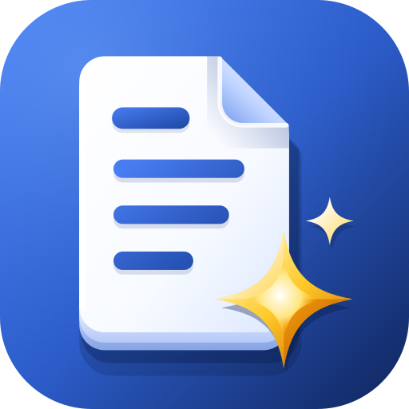

<p align="center">
  
</p>

<h1 align="center">NoteSpark</h1>

<p align="center">A smart note-taking app for students, built for Android.</p>

NoteSpark keeps all your class notes in one place. Type a note, scan a page with the camera, or write by hand
on the screen, and NoteSpark turns it into text you can edit. Notes are organized by course and saved in the
cloud with Firebase Cloud Firestore. Google ML Kit, running on the phone, then helps you study: it finds
deadlines, translates notes, summarizes them and makes flashcards.

## Features

- **Scan notes:** the ML Kit Document Scanner and Text Recognition turn a textbook page, handout or whiteboard into text
- **Handwriting to text:** write with a finger or a stylus; Digital Ink Recognition converts it
- **Upcoming deadlines:** Entity Extraction finds dates and times in your notes, and one tap adds them to your calendar
- **Translate:** Language Identification and Translation turn a note into English
- **Summarize:** Gemini Nano writes a short summary on supported phones
- **Flashcards:** study cards generated from a note
- **Organize:** filter notes by course, search them and pin the important ones
- **Share and export:** share a note as text or export it as a PDF; listen to it with text-to-speech
- **Cloud storage:** notes are saved in Firebase Cloud Firestore under a private anonymous account, and keep working offline

## Tech stack

| Area | Used |
| --- | --- |
| Language | Kotlin |
| Architecture | MVVM (ViewModel + LiveData), repositories, coroutines |
| UI | Android Views, View Binding, Material Components |
| Storage | Firebase Cloud Firestore, Firebase Authentication (anonymous) |
| ML | Google ML Kit: Text Recognition, Document Scanner, Digital Ink, Entity Extraction, Language ID, Translation, GenAI Summarization (Gemini Nano) |
| Build | Gradle (Kotlin DSL) with a version catalog |

## Requirements

- Android Studio (a version that supports AGP 9.4)
- JDK 17
- An Android phone or emulator running **Android 11 (API 30)** or newer, with Google Play services
- Summaries need a phone that supports Gemini Nano; every other feature works on any supported phone

## Getting started

1. Clone the repository:
   ```bash
   git clone https://github.com/Youssefrajeh/NoteSpark.git
   ```
2. Open the project in Android Studio and let Gradle sync.
3. Run the `app` configuration on a phone or emulator.

The ML Kit models (handwriting, entity extraction, translation) download the first time each feature is used,
so the first use needs an internet connection.

### Using your own Firebase project

The repository includes `app/google-services.json` for the team's Firebase project. To use your own instead:

1. In the [Firebase console](https://console.firebase.google.com/), add an Android app with the package name
   `com.group15.notemate` and download its `google-services.json` into `app/`.
2. Enable **Authentication → Sign-in method → Anonymous**.
3. Create a **Firestore Database** and publish these rules:
   ```
   rules_version = '2';
   service cloud.firestore {
     match /databases/{database}/documents {
       match /users/{userId}/{document=**} {
         allow read, write: if request.auth != null && request.auth.uid == userId;
       }
     }
   }
   ```

Each phone signs in anonymously and its notes are stored at `users/{uid}/notes/{noteId}`.

## Project structure

```
app/src/main/java/com/group15/notemate/
├── data/        Repositories: Firestore notes, settings, share/PDF export
├── ml/          ML Kit features (NoteAnalyzer) and text helpers
├── model/       Data classes: Note, Deadline, Flashcard…
├── ui/          Activities and adapters
└── viewmodel/   One ViewModel per screen
```

## Running the tests

```bash
./gradlew testDebugUnitTest
```

## Team

Group 15 · Section 03 · INFO-5126 Mobile Development Advanced · Fall 2026 · Professor Osam Ali-Ozkan

| Member | Role |
| --- | --- |
| Youssef Rajeh | ML features: scanning and text recognition, handwriting, deadlines, translation and summary |
| Abdul Maarouf | Flashcards and study mode, stats and streak dashboard |
| Urshit Patel | Main screen and note editor, QR sharing, About screen, theme and landscape layouts |
